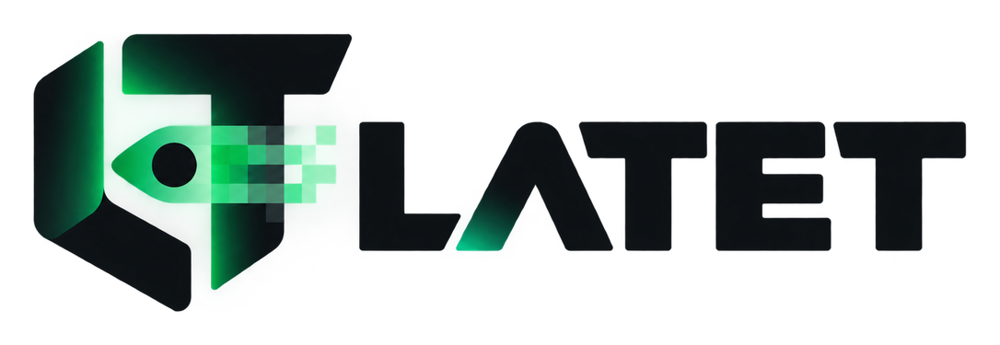
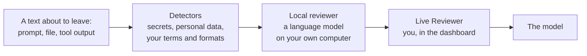
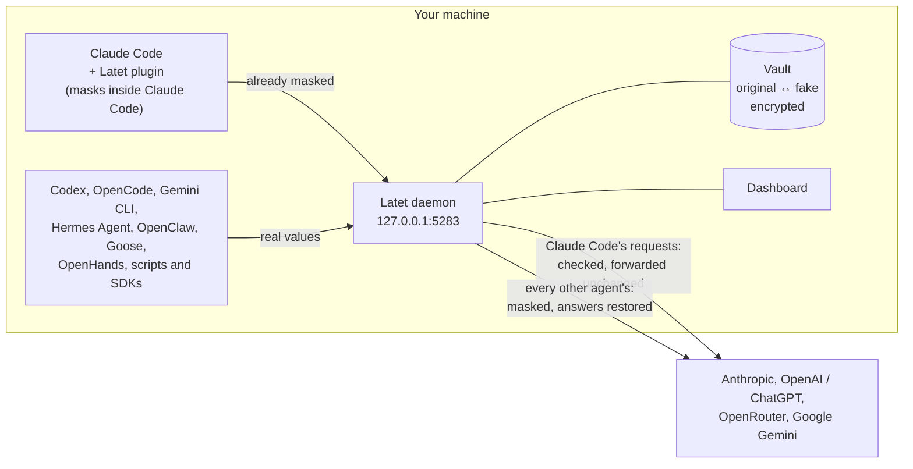

<h1 align="center">
  <picture>
    <source media="(prefers-color-scheme: dark)" srcset=".github/assets/latet_white.png">
    <source media="(prefers-color-scheme: light)" srcset=".github/assets/latet.png">
    
  </picture>
</h1>

<p align="center"><strong>A local privacy firewall for AI agents.</strong></p>

AI agents read for you: your code and its `.env`, databases, logs, mailboxes, the web. Coding
agents such as Claude Code and Codex do it at your request. Autonomous agents such as Hermes Agent,
OpenClaw, Goose and OpenHands do it on their own, for hours, with no one reading each step.
Everything they read is sent to a model in the cloud.

Latet stands between the agent and the model. It masks secrets and personal data before a request
leaves your machine and restores them locally in the answer, so the agent keeps working normally
and the provider never sees the real values.

**The best models for your sensitive work too.** Without it, work on customer data, health records
or credentials stays away from cloud models, or goes to a weaker local one. With it, the cloud
model gets the work, not the values.

**At the office too.** When your company reaches Claude or GPT through its own gateway, Amazon Bedrock,
Google Vertex, Microsoft Foundry or Azure OpenAI, Latet reads that route from the agent's settings
and goes in front of it: [Company endpoints](https://docs.latet.ai/agents/company-endpoints/).

**See it at work first.** Once it is [installed](#install), `latet tutorial` opens a sandbox in your
browser: a pretend agent sends requests full of invented secrets and personal data through the real
Latet, and chapter by chapter the dashboard shows what Latet did with each value. Nothing leaves
your computer, and none of your settings change: [Tutorial](https://docs.latet.ai/getting-started/tutorial/).

[](https://github.com/Latet-AI/latet/actions/workflows/ci.yml)
[](LICENSING.md)

Website: <https://latet.ai/> · Documentation: <https://docs.latet.ai/>, also in
[Italiano](https://docs.latet.ai/it/), [Deutsch](https://docs.latet.ai/de/),
[Français](https://docs.latet.ai/fr/) and [Español](https://docs.latet.ai/es/)

<p align="center">
  
</p>

## What it protects

Every request is checked before it leaves, whatever put the text in it: you, a file, a tool, the
agent's own instructions.

| What leaves your machine | For example | What Latet does |
| --- | --- | --- |
| Your prompts | *"Send the IBAN GB82 WEST 1234 5698 7654 32 to Emily Carter"* | Each value becomes a fake of the same shape, the name with the optional local name model; the answer comes back with the real ones |
| Files the agent reads | `.env`, `config.yaml`, test fixtures, a customer export | Keys, passwords, connection strings and personal data are masked; files the agent writes get the real values back |
| Command output and logs | `docker logs`, a stack trace, `kubectl describe` | Tokens, email addresses, public IP addresses and ID numbers in them are masked |
| Database queries | `psql`, or an MCP server answering `SELECT * FROM customers` | Secret columns always; with strict data mode every value, with fakes that keep joins and counts working |
| API responses | `curl` of an internal API, a webhook payload | Masked by value, and by field: a `password` or `token` field always |
| Web pages | An admin panel the agent opens with a browser tool | The personal data in the page's text is masked |
| Instructions | CLAUDE.md, AGENTS.md, the system prompt | Your name, user name, host name and company domain are masked |
| History | A session resumed ten days later | The same value gets the same fake, every time |
| Screenshots | A screenshot of an invoice | With the optional text recognition, the text in it is read on your machine and each value is covered with its fake; PDFs are flagged, or not sent (`images: block`) |
| What no pattern finds | *"Mark from sales is quietly interviewing at a competitor"* | The optional local reviewer, a language model on your computer, finds it before it leaves, following Latet's instructions and [your own guidance](https://docs.latet.ai/concepts/llm-review/#your-guidance): what counts as sensitive in your work, everywhere or in one project |

A key in `.env`, for example: the agent reads the file to learn the configuration, and the model
receives `pk_3a8d1f6b0e9c2a7d4b5e` instead of `pk_9f2c4e7a1b3d5f8e0a6c`. It writes the code that reads
the key from the environment, as it should; if a fake does come back, in a reply or in a command the
agent runs, Latet puts the real key back on your machine. See
[How it works](https://docs.latet.ai/concepts/how-it-works/).

## How it protects

- **Detects** secrets (API keys, tokens, passwords, `.env` values, private keys, connection strings)
  and personal data (emails, phone numbers, IBANs, card numbers, VAT numbers of 30 European
  countries and national ID and tax numbers of 15 countries, each confirmed by its check digits or a
  nearby keyword, and names and street addresses with the optional local name model). Your own
  terms and formats too: a client's name, or every badge number written `AB-123456`
  ([custom recognizers](https://docs.latet.ai/concepts/custom-recognizers/), with a
  [guide for AI agents](llms-rules.md) to write them).
- **Replaces** each value with a deterministic, format-preserving fake of the same shape, so code
  and configuration still make sense to the model.
- **Restores** the originals locally, in responses, streaming output and tool-call arguments, so
  files written by the agent contain the real values.
- **Adapts** to each project: a `latet.yaml` in a repository adds the project's own terms,
  formats and stricter rules, shared with everyone who works on it, and can never turn protection
  down; your own settings for a project may also loosen it, or turn Latet off there
  ([projects](https://docs.latet.ai/concepts/projects/)).
- **Reads** production data by its structure: the secret columns of a query result are always
  masked, and strict data mode masks every value of the tables, JSON and logs an agent reads; the
  dashboard proposes the columns that can stay in clear, such as ids, dates and states
  ([production data](https://docs.latet.ai/concepts/production-data/)).
- **Reviews**, if you want, everything the model did not write before it leaves, with a language
  model on your own computer: the names, health details and secrets in prose that no pattern finds
  ([below](#beyond-patterns-the-local-reviewer-and-the-live-reviewer)).
- **Asks you**, if you want, before anything new leaves: every prompt, file and tool output waits in
  the dashboard until you approve it, mask more in it, or stop it
  ([below](#beyond-patterns-the-local-reviewer-and-the-live-reviewer)).
- **Shows** exactly what was sent upstream and how it was masked, in a local dashboard
  (`latet dashboard`).

Everything runs on your machine. There is no Latet cloud service, no telemetry and no analytics.

## Beyond patterns: the local reviewer and the Live Reviewer

Detectors find what has a shape: a key, an email address, an IBAN, an ID number with its check
digits. A good deal of what matters has none.
*"Mark from sales is quietly interviewing at a competitor"*, a client named in passing in a log, a
password written in a sentence, the details of a contract in a customer's email: no pattern
recognises them, and an agent that reads files and tools for you brings plenty of them along.
Latet has two more layers for these, and each adds to what the one before masked; neither can
take anything away.



**The local reviewer** is a language model that runs on your own computer, or on a server of yours
(llama.cpp, Ollama, LM Studio). Before a text leaves, it reads what the detectors left in clear,
with their replacements shown as placeholders, and points out the names, health details,
addresses and secrets in prose. Latet masks them like any other value, wherever they appear from
then on.

- **Everything the model did not write** is read before it leaves: your prompts and attachments,
  the agent's instructions, and above all what its tools fetch, the part nobody types.
- **Nothing leaves without its review.** When the reviewer cannot answer, because its server is
  off or its answer is not to be trusted, the request is stopped. You can choose to send it masked
  by the detectors alone instead.
- **A text is read once,** and its review is remembered across restarts: history the agent sends
  again with every turn costs nothing more.
- **Your guidance:** Latet's own instructions to the reviewer are fixed, and shown in the
  dashboard as they are sent. After them you can add what only you know of your work (*ward names
  are confidential*, *PRJ- codes are internal projects*), for everything or for one project.
- **How much it finds:** on 93 invented cases, counting only what the detectors missed,
  Qwen3.5-4B found 84% (a prompt in under a second on a graphics card) and Ternary-Bonsai-2-27B 97%.
  Which local model works best as a reviewer is still open, and measurements from the community
  are welcome: [`benchmarks/llm-review/README.md`](benchmarks/llm-review/README.md) says how these were made,
  with [`scripts/llm_review_bench.py`](scripts/llm_review_bench.py), and
  [CONTRIBUTING.md](CONTRIBUTING.md#measuring-a-local-reviewer) how to send yours.
- **The original texts stay on your machines.** The server is on this computer, or on another
  machine of yours once you confirm it, reached over https (a self-signed certificate is trusted by
  its fingerprint).

**The Live Reviewer** is you, as the last check. Turn it on in the dashboard, and every new text
waits on the **Approvals** page before it leaves: the original next to what will be sent, with what
the detectors and the local reviewer masked, and what the reviewer only suggested.

- **Approve it, mask more, or stop it.** Select a value in the original and choose what it is; it
  leaves as a fake. A text you stop is never sent.
- **You can only add masking.** A value already masked cannot be put back in clear, and a value you
  mask stays masked from then on, everywhere.
- **In Claude Code it waits inside the plugin,** before Claude Code builds the request, piece by
  piece as prompts and tool outputs arrive; for the other agents, in the daemon, on the whole
  request. Nothing has a time limit unless you set one.
- **It suits the moments that matter:** a session on a customer's data, an agent you leave alone
  on a production system, the first days with a new project. *Approve all waiting* and letting
  texts with nothing found go by themselves keep it quick.

Without the local reviewer, what has no shape is only as safe as the detectors and the local name
model make it: turn the Live Reviewer on, or keep such text out of the agent's reach. See
[Local reviewer](https://docs.latet.ai/concepts/llm-review/) and
[Live Reviewer](https://docs.latet.ai/concepts/live-review/).

## Agents and services

| Agent | How it goes through Latet | Signed in with |
| --- | --- | --- |
| Claude Code: CLI, VS Code, JetBrains | Client mode: the Latet plugin, and the daemon checking each request | A Pro or Max subscription, or an API key |
| Claude Desktop's Code tab (local sessions) | Client mode, plugin only: the app ignores `ANTHROPIC_BASE_URL` | A subscription |
| Codex CLI and Codex Desktop | Gateway: `openai_base_url` in `~/.codex/config.toml` | ChatGPT, or an API key |
| OpenCode | Gateway: each provider's `baseURL` | API keys (Anthropic, OpenAI, OpenRouter) |
| Gemini CLI | Gateway: `latet gemini` sets `GOOGLE_GEMINI_BASE_URL` and `GOOGLE_VERTEX_BASE_URL` | A Gemini API key, or Vertex AI |
| Hermes Agent, OpenClaw, Goose, OpenHands, and any agent that takes an OpenAI-compatible base URL | Gateway: its base URL set to Latet ([autonomous agents](https://docs.latet.ai/agents/autonomous-agents/)) | An OpenAI or OpenRouter API key; Hermes Agent, ChatGPT too |
| Scripts and SDKs: the OpenAI, Anthropic and Google GenAI SDKs, LangChain, LangGraph, AutoGen, CrewAI, Aider, etc. | Gateway: `latet run <command>` points `OPENAI_BASE_URL`, `ANTHROPIC_BASE_URL` and `GOOGLE_GEMINI_BASE_URL` at Latet | API keys |
| GitHub Copilot (VS Code chat, Copilot CLI), JetBrains Junie CLI and AI Assistant, Zed, Cline, Kilo Code, Continue, Qwen Code, Crush | Gateway: the tool's own base URL or custom endpoint set to Latet ([other tools](https://docs.latet.ai/agents/other-tools/)); Copilot's inline suggestions are not covered | API keys |

Through the gateway, requests reach OpenAI (and ChatGPT, for Codex and Hermes Agent), OpenRouter
(Claude, Gemini and hundreds of other models), Anthropic's API, and Google's Gemini API and Vertex AI.
Not covered: Claude Desktop's Chat and Cowork signed in to Claude, cloud sessions (they run on the
provider's infrastructure), and Cursor, Windsurf, Antigravity, Jules, Kiro, Warp and the ChatGPT app,
whose requests leave from the vendor's servers
([what Latet cannot protect](https://docs.latet.ai/agents/other-tools/#what-latet-cannot-protect)).

- **Client mode**, for Claude Code: the plugin masks inside Claude Code, before the request is
  built. The daemon checks each request and forwards it unchanged; it stops one that would carry a
  sensitive value in clear.
- **Gateway mode**, for every other agent: the daemon on `127.0.0.1:5283` masks the request and
  restores the answer, streams included (SSE and WebSocket).



**Tested for real.** Each of these runs through a real Latet to a fake provider, set up as its guide
says, and its test checks that the provider never sees the secrets and that the agent gets them
back: Claude Code (on Bedrock and Vertex too), Codex, Gemini CLI, Hermes Agent, OpenClaw, Goose,
OpenHands, Aider, Qwen Code, Crush, the GitHub Copilot CLI, Junie CLI, and the CLIs of Cline, Kilo
Code and Continue; the OpenAI, Anthropic and Google GenAI SDKs, LangChain, LangGraph, AutoGen and
CrewAI. Tested live with real providers: the Claude Code CLI with a subscription and the Codex CLI
signed in with ChatGPT (WebSocket), with local name detection and the dashboard, and the local
reviewer with a model served by llama.cpp. GitHub Copilot in VS Code was tried by hand; Copilot in
JetBrains IDEs, JetBrains AI Assistant, Zed, Android Studio and Claude Desktop on a gateway are
documented, not tested. Every wire format is also tested in CI against a fake upstream. If an agent
does not work through Latet, please open an issue.

## Claude Pro and Max subscriptions

Latet works with Claude Code signed in with a Pro or Max subscription: no API key is needed.
Anthropic allows a subscription in Claude Code and its own apps
([Legal and compliance](https://code.claude.com/docs/en/legal-and-compliance)), and that is the only
place Latet uses one:

- **Claude Code is not modified.** Latet extends it with a plugin, through Claude Code's own
  plugin system, and points it at the local daemon with `ANTHROPIC_BASE_URL`, the setting Anthropic
  documents for [gateways](https://code.claude.com/docs/en/llm-gateway), a subscription login
  included.
- **Your sign-in stays Anthropic's.** You log in with Claude Code's own login. Latet never asks
  for your credentials, never reads them for itself and never stores them.
- **Each request is the one Claude Code built.** The plugin masks inside Claude Code, before the
  request is built. The daemon then forwards it byte for byte, headers included, as Anthropic's
  [gateway guide](https://code.claude.com/docs/en/llm-gateway-protocol) asks a gateway to do: it
  inspects without modifying. Your token passes through it and is never saved or logged.
- **No one else uses your subscription.** The other agents go through the gateway with their own
  API keys.

Latet takes no work away from your provider: it brings it the work you would otherwise keep from
it.

This describes how Latet works; it is not legal advice.

**Claude Code's auto mode:** its reviewer is sent your OS user name and the paths of your home and
working directories, which no plugin can mask. Latet blocks those reviews by default (auto mode then
cannot approve actions by itself); `auto_mode_review` lets each detail through to the reviewer, or
gives it a fake user name. See [Claude Code](https://docs.latet.ai/agents/claude-code/).

## Run your agent through Latet

The usual way is to start the agent through Latet, the session you want protected:

- **`latet claude`, `latet codex` or `latet opencode`** runs that agent through Latet. It
  starts the daemon and gives the agent what it needs for that session only: none of the agent's
  settings change, and when the session ends the agent works as before. Every argument passes
  through: `latet claude --resume`.
- `claude` started on its own does not go through Latet. That is the price of changing nothing.

**For every session, once Latet fits your work:** `latet global-install` points your agents at
Latet for good, in the terminal and in the IDE, so no session can start without it. It is worth it
once your terms, formats and projects are set and the false positives marked *Not sensitive*, and
on a machine where a forgotten session would matter: a customer's data, an autonomous agent left
alone. It shows everything it would change and asks once; it backs each agent's settings up first,
and `latet global-uninstall` takes it all away, the settings restored byte for byte.
`latet agents apply` routes one agent you install later.

**Setting Latet up takes some time.** The defaults protect at once what has a shape: keys,
passwords, email addresses, IBANs, ID numbers. Making it fit you takes longer: your clients'
names and internal codes as terms and recognizers (`latet rules suggest` finds the formats),
the false positives marked *Not sensitive* from the dashboard, a project's own rules, and the
local reviewer for what has no shape. The dashboard shows each request as it left, so you see
what to add as you work.

`latet run <command>` is for scripts and SDKs: it runs the command with `OPENAI_BASE_URL`,
`ANTHROPIC_BASE_URL` and `GOOGLE_GEMINI_BASE_URL` pointing at Latet, so a program that reads them
goes through it (`latet run python summarize.py`). A program that does not read them runs as usual.

## Install

Requirements: Windows, macOS or Linux. The installers set up [uv](https://docs.astral.sh/uv/), which
also provides a Python Latet is tested on (3.12 or 3.13).

On macOS and Linux:

```sh
curl -LsSf https://raw.githubusercontent.com/Latet-AI/latet/main/scripts/install.sh | sh
```

On Windows (PowerShell):

```powershell
irm https://raw.githubusercontent.com/Latet-AI/latet/main/scripts/install.ps1 | iex
```

Both install the latest [release](https://github.com/Latet-AI/latet/releases) from GitHub with uv,
local name detection and text in images included, and change nothing else: start your agent with
`latet claude` as above, and run `latet global-install` when it fits your work. `latet upgrade`
installs the next release the same way.

**Recommended: names and images from day one.** Patterns find what has a shape, such as a key, an
email address or an IBAN. A name in a sentence has none (*Emily Carter lives at 42 Mill Lane*):
the local name model finds it. The text in a screenshot needs text recognition, or the image leaves
as it is. The installers install what both run on; download their models once:

```sh
latet ner install   # names and street addresses: about 1.6 GB
latet ocr install   # the text in images: about 31 MB
```

Both run on this computer only: the models come once from huggingface.co, checked against pinned
hashes, and nothing is sent anywhere. `latet global-install --ner --ocr` downloads them with the
rest of its setup.

**With an AI agent:** point it at [`llms-install.md`](llms-install.md). It installs Latet, which
changes nothing on its own, then tells you how you can go on (try it one session at a time, have it
on for every session, set up your other tools, download the local models) and waits for your choice:
it runs `latet global-install` only if you choose every session. Later, [`llms-config.md`](llms-config.md) lets it change
Latet's settings for you: what adds protection applies, what lowers it waits for your approval in
the dashboard. That is a guardrail against mistakes, not a lock: an agent runs as you, so it cannot
hold against one misled by a prompt injection
([Agents and your settings](https://docs.latet.ai/concepts/agents-and-settings/)).

**With Docker**, if you prefer: `docker compose up -d` with
[`compose.yaml`](compose.yaml), then `docker exec latet latet agents print` shows how to point
each agent at the container. See [Docker](https://docs.latet.ai/getting-started/docker/).

**From a checkout** (also needs Node.js 22.12 or newer, to build the dashboard; installed from the
repository's address, `git+https://...`, Latet would come without it):

```sh
git clone https://github.com/Latet-AI/latet.git
cd latet
cd dashboard && npm ci && npm run build && cd ..   # the dashboard ships inside the package
uv tool install --force ".[ner,ocr]"               # or "." without names and images
```

To work on Latet itself, see [CONTRIBUTING.md](CONTRIBUTING.md).

## Quickstart

1. **See it at work.** New to Latet? `latet tutorial` shows it at work in about 30 minutes, in
   your browser: a pretend agent and a pretend model, the real Latet between them, and invented
   data. Nothing leaves your computer, and none of your settings change. See
   [Tutorial](https://docs.latet.ai/getting-started/tutorial/).
2. **Try it**, changing nothing: in a scratch folder, put a made-up key in a `.env` file, start
   `latet claude` (or `latet codex`) there, and ask the agent to copy the key into another
   file. Then run `latet dashboard`: the request shows a fake, and the file on disk contains the
   original.
3. **Work with it:** keep starting your agent with `latet claude`, and look at the dashboard now
   and then. Add your own terms, mark the false positives *Not sensitive*, and turn on the
   [local reviewer](https://docs.latet.ai/concepts/llm-review/) if you have a graphics
   card, or the [Live Reviewer](https://docs.latet.ai/concepts/live-review/) when the
   data matters.
4. **Turn it on for good**, once it fits: `latet global-install` detects your agents and shows
   what it would change: the Claude Code plugin in every session, each agent pointed at the local
   daemon, the daemon started at login, the profile (below). It asks once. Restart your agents
   afterwards.

| Profile | Masks |
| --- | --- |
| `balanced` (default) | Secrets, personal data, your own terms and this machine's identity; names and street addresses in your prompts, with the optional local name model |
| `max` | All of `balanced`, plus private IP addresses, names everywhere and every value of the tables and JSON a tool prints (strict data mode); requests carrying images or PDFs are not sent |
| `secrets` | Secrets and your own terms only |

### Everyday commands

| Command | What it does |
| --- | --- |
| `latet dashboard` | Open the dashboard: what was sent, and how it was masked |
| `latet doctor` | Check the daemon, the plugin, masking and every agent integration |
| `latet status`, `latet start`, `latet stop` | The background daemon |
| `latet reload` | Apply edits to `config.yaml` without a restart |
| `latet config get`, `set`, `add`, `remove` | Read and change a setting; what lowers protection waits for your approval |
| `latet project show`, `init`, `off` | What applies in a project, a `latet.yaml` to start from, Latet off in one project |
| `latet rules suggest`, `test`, `add` | Find formats no rule covers (shapes only), check your own recognizers, add them |
| `latet rules export`, `import` | Your rules in a file for a colleague; what an import would lower is left out unless you ask |
| `latet backup`, `latet restore` | Your installation in one encrypted file, the vault and its key with `--vault`, for another machine |
| `latet llm status`, `test` | Check the local reviewer's server, review a text as Latet would |
| `latet ner install` | Download the local name and address model (about 1.6 GB, once) |
| `latet ocr install` | Download the text recognition models for images (about 31 MB, once) |
| `latet tutorial` | See Latet at work in your browser, on a sandbox of its own with invented data (about 30 minutes) |
| `latet claude`, `latet codex`, `latet opencode` | Run one agent through Latet for one session, without changing its settings |
| `latet global-install` | Route your agents through Latet for good: it shows what it changes, and asks once |
| `latet global-uninstall` | Take it all away: agent settings restored byte for byte, start at login removed, daemon stopped |
| `latet connect`, `latet disconnect` | Connect this computer to a Latet server, or revoke its connection |
| `latet server people`, `keys`, `config`, `status` | Administer a Latet server with an administration token |

To uninstall: `latet global-uninstall`, then `uv tool uninstall latet`. Every command and option
is in the [CLI reference](https://docs.latet.ai/reference/cli/).

## Latet on a server

For a team, one Latet can run on a server instead of on each computer: people's agents, and
programs such as a CI pipeline, send their requests to it over HTTPS, and it masks them there. It
runs on several instances, with PostgreSQL and Valkey behind them.

**In practice:**

1. The administrator starts the server, with the server profile of `compose.yaml` (PostgreSQL,
   Valkey, two instances and Caddy) or as a systemd or Windows service
   (`latet server service install` shows its plan first), and adds each person, which prints a
   one-time code: `latet server --server https://latet.acme.lan people add "Emily Carter"`.
2. Emily installs Latet on her computer as usual and runs `latet connect https://latet.acme.lan`
   with that code. From then on her agents' requests go through the server, and `latet dashboard`
   opens her space there.
3. A program gets an API key instead:
   `latet server --server https://latet.acme.lan keys add "Billing CI" --out billing.key`.

**What is whose.** Each person and each API key has a separate space, with its own vault, history,
settings and rules. The server shares with every space only what it needs to run: its destinations,
its local reviewer, text recognition and how long history is kept.

**Sharing rules.** A team shares its rules by hand: one person exports them to a file with
`latet rules export`, and the others import it. Rules set once for everyone, which nobody can lower,
are planned for the Enterprise Edition.

**Administration.** The administration commands add and remove people and API keys, set the rules
of each API key and the shared settings, and show the administration log. Metrics have a listener
of their own, which asks for a token.

**Trust.** Original data can reach the server and the dashboards people sign in to: trust its
administrators, and any reviewer it uses, accordingly. Gateway requests are masked on the server;
Claude Code masks with its plugin, and the server checks each of its requests (the connected helper
runs in Windows terminals). The server is a company control point only when network rules stop
direct access to the providers.

An administrator sets the server up in their own terminal: its administration and `latet connect`
refuse to run inside an AI agent, since they hold the keys to everyone's space. An agent can still
explain the steps and check the machine: point it at [`llms-server.md`](llms-server.md).

See [server setup, connection and administration](https://docs.latet.ai/getting-started/server/)
and [server operations](https://docs.latet.ai/concepts/server-operations/).

## Privacy guarantees and limits

For Latet running locally on your computer, the intended guarantees are:

- Values it **detects** are replaced before the request leaves your machine, and the mapping to the
  originals stays local.
- In client mode, the daemon never modifies a request; it can only block one that carries a value
  the detectors find in clear.

What it cannot do:

- **Only what the detectors recognize is masked.** Unusual formats, encoded values or personal data
  in free text can pass through. Names in free text need the optional local name model or the local
  reviewer, and both are best effort.
- **The text in images is masked only with the optional text recognition, and best effort**: text
  it does not read leaves as it is. PDFs and other documents are not read: they are sent as they
  are and flagged, or not sent at all with the `max` profile or `images: block`.
- **claude.ai connectors** (Gmail, Calendar, Slack...) run on Anthropic's servers, so Latet keeps
  the fakes in their arguments: a connector searching for a masked name searches for the fake one.
- **Uncovered surfaces** (Claude Desktop Chat and Cowork, cloud sessions, Cursor) are out of reach.
- **Context still leaks:** file names, code structure and the surrounding text are sent as they are,
  and fakes keep the shape of the original.
- **Latet is not a sandbox.**

For a connected deployment, see the [server trust boundary](https://docs.latet.ai/concepts/server/).
See [What is and isn't protected](https://docs.latet.ai/concepts/protection-scope/) and
the [threat model](https://docs.latet.ai/security/).

## Roadmap

What comes next is on the [roadmap](https://docs.latet.ai/roadmap/), and what changed
in each version is in the [changelog](https://docs.latet.ai/changelog/).

## Latet Enterprise

Latet Enterprise is for a company whose security team sets the rules for everyone. On top of the
Community Edition it adds rules for everyone that nobody can lower, central approvals of changes that
lower protection, single sign-on, audit reports and events for a SIEM. It is coming:
[join the waitlist](https://latet.ai/#waitlist) to hear when it is out.

## Bugs and feature requests

Found a bug, or missing a feature? [Open an issue](https://github.com/Latet-AI/latet/issues/new):
bugs and feature requests are tracked there, and that is where you get an answer.

- **A bug:** what you did, what you expected and what happened instead, with the output of
  `latet version` and `latet doctor`, your agent and your operating system.
- **A feature:** what you are trying to do, and what Latet does today. A concrete case (the value
  that should be masked, the agent you use) says more than a general description.

Use invented values in an issue, never a real key, password or someone's data. A security problem is
not an issue: report it privately, as [SECURITY.md](SECURITY.md) explains.

## Contributing and security

Pull requests are welcome: [CONTRIBUTING.md](CONTRIBUTING.md) explains the development setup and the
checks CI runs. For a new feature, open an issue first, so that what it does is agreed before the
code. Your first pull request accepts the [contributor license agreement](CLA.md): you keep your
copyright. To report a vulnerability, follow [SECURITY.md](SECURITY.md); please do not open a public
issue for it.

## License

Latet is source-available under the [Latet Sustainable Use License](LICENSE). The Community Edition is
free for everyone, companies of any size included, for their own work, for personal use and for any
non-commercial use. Selling Latet, offering it to others as a service, building it into a product you
sell or making a commercial fork of it needs a commercial license: write to
[info@latet.ai](mailto:info@latet.ai). The files in `ee` directories are the Enterprise Edition, under
the [Latet Enterprise License](ee/LICENSE). [LICENSING.md](LICENSING.md) explains it in plain words,
and [THIRD_PARTY_NOTICES.md](THIRD_PARTY_NOTICES.md) lists the third-party components and their
license texts (generated by `scripts/gen_notices.py`).

## Acknowledgements

Latet stands on the work of these projects. Thank you to their authors and contributors.

**Vendored or ported code**

| Project | Used for | License |
| --- | --- | --- |
| [gitleaks](https://github.com/gitleaks/gitleaks) | Default secret-detection ruleset, vendored and converted for RE2 | MIT |
| [Presidio](https://github.com/data-privacy-stack/presidio) (formerly Microsoft Presidio) | PII recognizers ported (patterns, context words, checksum validation) | MIT |

**Runtime dependencies**

| Project | Used for | License |
| --- | --- | --- |
| [phonenumbers](https://github.com/daviddrysdale/python-phonenumbers) | Phone number parsing and validation | Apache-2.0 |
| [google-re2](https://pypi.org/project/google-re2/) / [RE2](https://github.com/google/re2) | Linear-time regular expressions | BSD-3-Clause |
| [Starlette](https://github.com/Kludex/starlette) | ASGI framework for the daemon | BSD-3-Clause |
| [Uvicorn](https://github.com/Kludex/uvicorn) | ASGI server | BSD-3-Clause |
| [HTTPX](https://github.com/encode/httpx) | HTTP client for upstream requests | BSD-3-Clause |
| [websockets](https://github.com/python-websockets/websockets) | WebSocket relay | BSD-3-Clause |
| [Pydantic](https://github.com/pydantic/pydantic) | Data validation | MIT |
| [Typer](https://github.com/fastapi/typer) | Command-line interface | MIT |
| [python-zstandard](https://github.com/indygreg/python-zstandard) | Zstandard compression | BSD-3-Clause |
| [Brotli](https://github.com/google/brotli) | Brotli compression | MIT |
| [TOML Kit](https://github.com/python-poetry/tomlkit) | Style-preserving TOML reading and editing | MIT |
| [keyring](https://github.com/jaraco/keyring) | Access to the operating system's credential store | MIT |
| [cryptography](https://github.com/pyca/cryptography) | Cryptographic primitives | Apache-2.0 OR BSD-3-Clause |
| [truststore](https://github.com/sethmlarson/truststore) | TLS verification with the operating system's certificate store | MIT |
| [platformdirs](https://github.com/tox-dev/platformdirs) | Per-platform data and configuration directories | MIT |
| [PyYAML](https://github.com/yaml/pyyaml) | YAML parsing | MIT |

**Optional local name detection (`latet[ner]`)**

| Project | Used for | License |
| --- | --- | --- |
| [Privacy Filter](https://huggingface.co/openai/privacy-filter) by OpenAI | The name and address model, downloaded on request | Apache-2.0 |
| [ONNX Runtime](https://github.com/microsoft/onnxruntime) | Local model inference | MIT |
| [Tokenizers](https://github.com/huggingface/tokenizers) | Model tokenization | Apache-2.0 |
| [NumPy](https://github.com/numpy/numpy) | Model inputs and outputs | BSD-3-Clause |

**Optional text in images (`latet[ocr]`)**

| Project | Used for | License |
| --- | --- | --- |
| [PaddleOCR](https://github.com/PaddlePaddle/PaddleOCR) PP-OCRv6 small, [detection](https://huggingface.co/PaddlePaddle/PP-OCRv6_small_det_onnx) and [recognition](https://huggingface.co/PaddlePaddle/PP-OCRv6_small_rec_onnx) in ONNX | The text recognition models, downloaded on request | Apache-2.0 |
| [ONNX Runtime](https://github.com/microsoft/onnxruntime) | Local model inference | MIT |
| [Pillow](https://github.com/python-pillow/Pillow) | Reading, painting and writing images | MIT-CMU |
| [IBM Plex Sans](https://github.com/IBM/plex) | The font the fakes are written in, included unmodified | OFL-1.1 |
| [NumPy](https://github.com/numpy/numpy) | Model inputs and outputs | BSD-3-Clause |

**Optional Latet on a server (`latet[server]`)**

| Project | Used for | License |
| --- | --- | --- |
| [psycopg](https://github.com/psycopg/psycopg) | PostgreSQL driver and connection pool, used as a separate, unmodified package | LGPL-3.0-only |
| [redis-py](https://github.com/redis/redis-py) | Client for Valkey and Redis | MIT |

**Dashboard and documentation site**

| Project | Used for | License |
| --- | --- | --- |
| [React](https://github.com/react/react) | Dashboard UI | MIT |
| [React Router](https://github.com/remix-run/react-router) | Dashboard navigation | MIT |
| [Vite](https://github.com/vitejs/vite) | Dashboard build | MIT |
| [Tailwind CSS](https://github.com/tailwindlabs/tailwindcss) | Dashboard styling | MIT |
| [i18next](https://github.com/i18next/i18next) and [react-i18next](https://github.com/i18next/react-i18next) | Dashboard translations | MIT |
| [Astro](https://github.com/withastro/astro) and [Starlight](https://github.com/withastro/starlight) | Documentation site | MIT |
| [Pagefind](https://github.com/Pagefind/pagefind) | Local, static search for the documentation | MIT |

**Development**

| Project | Used for | License |
| --- | --- | --- |
| [pytest](https://github.com/pytest-dev/pytest) | Test runner | MIT |
| [pytest-asyncio](https://github.com/pytest-dev/pytest-asyncio) | Async tests | Apache-2.0 |
| [pytest-socket](https://github.com/miketheman/pytest-socket) | Blocking network access in tests | MIT |
| [Hypothesis](https://github.com/HypothesisWorks/hypothesis) | Property-based testing | MPL-2.0 |
| [python-stdnum](https://github.com/arthurdejong/python-stdnum) | Reference validation of identifiers, in tests only (not distributed) | LGPL-2.1-or-later |
| [Ruff](https://github.com/astral-sh/ruff) | Linting and formatting | MIT |
| [Pyright](https://github.com/microsoft/pyright) (via [pyright-python](https://github.com/RobertCraigie/pyright-python)) | Static type checking | MIT |
| [uv](https://github.com/astral-sh/uv) | Python packaging and environments | Apache-2.0 OR MIT |
| [Hatchling](https://github.com/pypa/hatch) | Build backend | MIT |
| [TypeScript](https://github.com/microsoft/TypeScript), [ESLint](https://github.com/eslint/eslint) and [Vitest](https://github.com/vitest-dev/vitest) | Dashboard type checking, linting and tests | Apache-2.0, MIT, MIT |
| [CycloneDX Python](https://github.com/CycloneDX/cyclonedx-python) | Release SBOM | Apache-2.0 |

### Prior art and inspiration

Latet learned from projects that explored the same space before it: Stacklok's
[CodeGate](https://github.com/stacklok/codegate) (now archived), a local gateway that redacted
secrets for AI coding assistants; [PasteGuard](https://github.com/sgasser/pasteguard), a local-first
privacy proxy; [LiteLLM](https://github.com/BerriAI/litellm)'s
[Presidio guardrail](https://docs.litellm.ai/docs/proxy/guardrails/pii_masking_v2) for masking PII
in LLM traffic; and two tools for looking at what Claude Code actually sends,
[claude-code-proxy](https://github.com/seifghazi/claude-code-proxy) by seifghazi and
[claude-trace](https://github.com/badlogic/lemmy/tree/main/apps/claude-trace) by badlogic.
