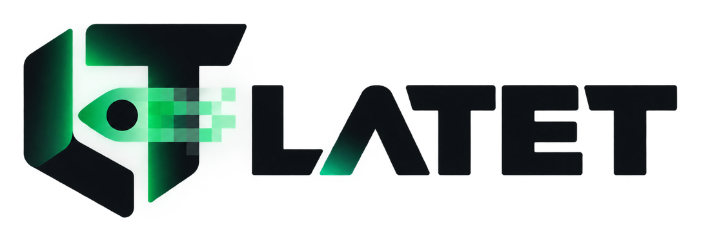
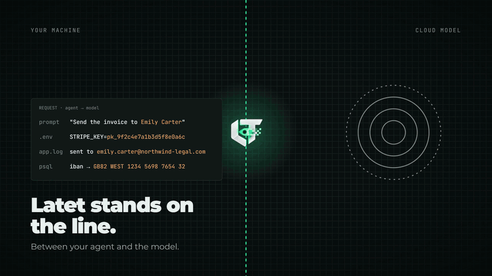
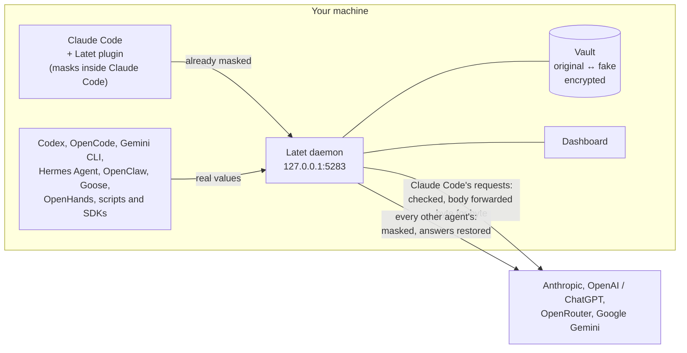

<h1 align="center">
  <picture>
    <source media="(prefers-color-scheme: dark)" srcset=".github/assets/latet_white.png">
    <source media="(prefers-color-scheme: light)" srcset=".github/assets/latet.png">
    
  </picture>
</h1>

<p align="center"><strong>A local privacy firewall for AI agents.</strong></p>

Latet stands between your AI agent and the cloud model. Before a request leaves your machine, it
swaps the secrets and personal data in it for fakes of the same shape, and when the answer comes
back, it puts the real values back. The agent keeps working normally, and the provider never sees
the real values.

<p align="center">
  <a href="#quick-start"><strong>Quick start</strong></a> ·
  <a href="#what-it-protects"><strong>What it protects</strong></a> ·
  <a href="#agents-and-services"><strong>Agents</strong></a> ·
  <a href="#privacy-guarantees-and-limits"><strong>Limits</strong></a> ·
  <a href="https://docs.latet.ai/"><strong>Documentation</strong></a> ·
  <a href="https://latet.ai/"><strong>Website</strong></a>
</p>

<p align="center">
  <a href="https://github.com/Latet-AI/latet/actions/workflows/ci.yml"></a>
  <a href="https://pypi.org/project/latet/"></a>
  <a href="LICENSING.md"></a>
</p>

Your agent reads your files, your logs and your prompts, and sends them to the model. With Latet in
between, this is what the model receives:

| What the agent read | On your machine | What the model receives |
| --- | --- | --- |
| An API key in `.env` | `pk_9f2c4e7a1b3d5f8e0a6c` | `gd_1a2f2438f7bc60e0f872` |
| An email address in a log | `emily.carter@northwind-legal.com` | `laura.bennett@contoso-4f1a.example` |
| An IBAN in your prompt | `GB82WEST12345698765432` | `GB87QQAV21922168089985` |
| Your user name in a path | `C:\Users\ecarter\shop\app.py` | `C:\Users\oliver75\shop\app.py` |

The model writes the code that reads the key from the environment, as it should. If a fake does come
back, in a reply, in a file the agent writes or in a command it runs, Latet puts the real value back
on your machine. A value gets the same fake every time, derived from a key created on your machine:
the values above are examples.

## Quick start

Latet runs on Windows, Linux and macOS on Apple silicon. The installer sets up
[uv](https://docs.astral.sh/uv/), installs the latest release with it, and changes nothing else.

```sh
# macOS and Linux; then open a new terminal
curl -LsSf https://raw.githubusercontent.com/Latet-AI/latet/main/scripts/install.sh | sh
```

```powershell
# Windows (PowerShell)
irm https://raw.githubusercontent.com/Latet-AI/latet/main/scripts/install.ps1 | iex
```

Then run one session of your agent through Latet, and look at what left:

```sh
latet claude       # or latet codex, latet opencode: for this session, nothing else changes
latet dashboard    # each request as it was sent, and how it was masked
```

**See it work.** In a scratch folder, put a made-up key in a `.env` file, start `latet claude` there,
and ask the agent to copy the key into another file. The dashboard shows a fake in the request, and
the file on disk contains the original.

**Or try it on invented data first.** `latet tutorial` opens a sandbox in your browser: a pretend
agent and a pretend model with the real Latet between them, in about 30 minutes. Nothing leaves your
computer, and none of your settings change.

**With an AI agent:** point it at [`llms-install.md`](llms-install.md). It installs Latet, which
changes nothing on its own, and asks you how to go on.

The optional local models for names and for the text in images are under [Install](#install), and
`latet global-install`, which routes your agents through Latet for every session, under
[Using Latet day to day](#using-latet-day-to-day).

<p align="center">
  
  <br><sub><a href=".github/assets/latet-product.gif">The whole video, 45 seconds</a></sub>
</p>

## Why Latet

- **The best models for your sensitive work too.** Without Latet, work on customer data, health
  records or credentials stays away from cloud models, or goes to a weaker local one. With it, the
  cloud model gets the work, not the values.
- **Fakes of the same shape, not placeholders.** A key still looks like a key and an email address
  like an email address, so code and configuration still make sense to the model. The same value
  gets the same fake every time, even in a session resumed days later.
- **Everything the agent reads, not only what you type.** Your prompts, the files the agent reads,
  command output and logs, database results, API responses, web pages and instructions such as
  CLAUDE.md are checked before they leave. The real values come back in answers, streamed output and
  tool calls, so the files the agent writes contain them.
- **The agents you already use, with their own sign-in.** Claude Code with a Pro or Max subscription
  or an API key, through Claude Code's own plugin system and without modifying it; Codex signed in
  with ChatGPT or with an API key; Gemini CLI, OpenCode, Hermes Agent, OpenClaw, Goose, OpenHands and
  any agent that takes an OpenAI-compatible base URL. At work, Latet goes in front of your company's
  gateway, Amazon Bedrock, Google Vertex, Microsoft Foundry or Azure OpenAI
  ([company endpoints](https://docs.latet.ai/agents/company-endpoints/)).
- **What no pattern finds.** An optional local reviewer, a language model on your own computer,
  points out the names, health details and secrets written in prose, and an optional Live Reviewer
  holds each new text in the dashboard until you approve it.
- **Nothing goes to a Latet cloud.** Everything runs on your machine: there is no Latet cloud
  service, no telemetry and no analytics. A local dashboard shows exactly what was sent and how it
  was masked.
- **In five languages.** The dashboard and the [documentation](https://docs.latet.ai/) are in
  English, [Italiano](https://docs.latet.ai/it/), [Deutsch](https://docs.latet.ai/de/),
  [Français](https://docs.latet.ai/fr/) and [Español](https://docs.latet.ai/es/).

**What it does not do.** Latet masks what it recognizes. A value in an unusual format or encoded in
base64 can pass, and so can a name in free text without the optional local models, which are best
effort. File names and code structure are sent as they are, and Latet is not a sandbox. Cursor,
Windsurf and the other tools whose requests leave from the vendor's servers are out of its reach.
The full list is under [Privacy guarantees and limits](#privacy-guarantees-and-limits).

**For a team, your own programs and a company.** One Latet on a server masks for everyone's agents
and for programs such as a CI pipeline, and its HTTP API, the `latet-client` Python SDK and the n8n
nodes let your applications mask log lines and documents: [Latet on a server](#latet-on-a-server),
[your own programs](#your-own-programs-api-python-sdk-langchain-and-n8n). The
[Enterprise Edition](#enterprise-edition) adds locked rules, single sign-on and audit reports for a
company's security team.

**Free for your own work.** Latet is source-available under the
[Latet Sustainable Use License](LICENSE). The Community Edition is free for everyone, companies of
any size included, for their own work; [Editions and license](#editions-and-license) says what needs
a commercial license.

## What it protects

Every request is checked before it leaves, whatever put the text in it: you, a file, a tool, the
agent's own instructions.

| What leaves your machine | For example | What Latet does |
| --- | --- | --- |
| Your prompts | *"Send the IBAN GB82 WEST 1234 5698 7654 32 to Emily Carter"* | Each value becomes a fake of the same shape (a name with the optional local name model), and the answer comes back with the real ones |
| Files the agent reads | `.env`, `config.yaml`, test fixtures, a customer export | Keys, passwords, connection strings and personal data are masked; files the agent writes get the real values back |
| Command output and logs | `docker logs`, a stack trace, `kubectl describe` | Tokens, email addresses, public IP addresses and ID numbers in them are masked |
| Database queries | `psql`, or an MCP server answering `SELECT * FROM customers` | Secret columns always; with strict data mode every value, with fakes that keep joins and counts working |
| API responses | `curl` of an internal API, a webhook payload | Masked by value, and by field: a `password` or `token` field always |
| Web pages | An admin panel the agent opens with a browser tool | The personal data in the page's text is masked |
| Instructions | CLAUDE.md, AGENTS.md, the system prompt | Your name, user name, host name and company domain are masked |
| History | A session resumed ten days later | The same value gets the same fake, every time |
| Screenshots | A screenshot of an invoice | With the optional text recognition, each value in it is covered with its fake on your machine; without it, and with a PDF, the request is not sent |
| What no pattern finds | *"Mark from sales is quietly interviewing at a competitor"* | The optional local reviewer, a language model on your computer, finds it before it leaves, with [your own guidance](https://docs.latet.ai/concepts/llm-review/#your-guidance) on what counts as sensitive in your work |

See [How it works](https://docs.latet.ai/concepts/how-it-works/).

## How it works

- **Detects** secrets (API keys, tokens, passwords, `.env` values, private keys, connection strings)
  and personal data (emails, phone numbers, IBANs, card numbers, VAT numbers of 30 European
  countries and national ID and tax numbers of 15 countries, each confirmed by its check digits or a
  nearby keyword, and names and street addresses with the optional local name model). Your own
  terms and formats too: a client's name, or every badge number written `AB-123456`
  ([custom recognizers](https://docs.latet.ai/concepts/custom-recognizers/), with a
  [guide for AI agents](llms-rules.md) to write them).
- **Replaces** each value with a deterministic, format-preserving fake of the same shape.
- **Restores** the originals locally, in responses, streaming output and tool-call arguments.
- **Adapts** to each project: a `latet.yaml` in a repository adds the project's own terms, formats
  and stricter rules, shared with everyone who works on it, and can never turn protection down
  ([projects](https://docs.latet.ai/concepts/projects/)).
- **Reads every part of a request** before it leaves: its path, query, headers and body. A part no
  profile names, or a call Latet does not read, is not sent, unless an exact exception you approved
  lets it through ([every part of a request](https://docs.latet.ai/concepts/protection-scope/#every-part-of-a-request)).
- **Reads production data** by its structure: the secret columns of a query result are always
  masked, and strict data mode masks every value of the tables, JSON and logs an agent reads
  ([production data](https://docs.latet.ai/concepts/production-data/)).
- **Shows** exactly what was sent upstream and how it was masked, in a local dashboard
  (`latet dashboard`).

### The local reviewer and the Live Reviewer

Detectors find what has a shape: a key, an email address, an IBAN, an ID number with its check
digits. A good deal of what matters has none: *"Mark from sales is quietly interviewing at a
competitor"*, a client named in passing in a log, a password written in a sentence. Latet has two
more layers for these, and each adds to what the one before masked; neither can take anything away.

**The local reviewer** is a language model that runs on your own computer, or on a server of yours
(llama.cpp, Ollama, LM Studio). Before a text leaves, it reads what the detectors left in clear and
points out the names, health details, addresses and secrets in prose; Latet masks them like any
other value. It reads everything the model did not write, above all what the agent's tools fetch.
When it cannot answer, the request is stopped, unless you choose to send it masked by the detectors
alone. You can add to its instructions what only you know of your work (*PRJ- codes are internal
projects*).

On 93 invented cases, counting only what the detectors missed, Qwen3.5-4B found 84% (a prompt in
under a second on a graphics card) and Ternary-Bonsai-2-27B 97%. Which local model works best as a
reviewer is still open, and measurements from the community are welcome:
[`benchmarks/llm-review/README.md`](benchmarks/llm-review/README.md) says how these were made, and
[CONTRIBUTING.md](CONTRIBUTING.md#measuring-a-local-reviewer) how to send yours.

**The Live Reviewer** is you, as the last check. Turn it on in the dashboard, and every new text
waits on the **Approvals** page before it leaves, the original next to what will be sent: approve
it, mask more in it, or stop it. You can only add masking, never put a masked value back in clear.

Without the local reviewer, what has no shape is only as safe as the detectors and the local name
model make it: turn the Live Reviewer on, or keep such text out of the agent's reach. See
[Local reviewer](https://docs.latet.ai/concepts/llm-review/) and
[Live Reviewer](https://docs.latet.ai/concepts/live-review/).

## Agents and services

| Agent | How it goes through Latet | Signed in with |
| --- | --- | --- |
| Claude Code: CLI, VS Code, JetBrains | Client mode: the Latet plugin, and the daemon checking each request | A Pro or Max subscription, or an API key |
| Claude Desktop's Code tab (local sessions) | Client mode, plugin only: the app ignores `ANTHROPIC_BASE_URL` | A subscription |
| Codex CLI and Codex Desktop | Gateway: `openai_base_url` in `~/.codex/config.toml` | ChatGPT, or an API key |
| OpenCode | Gateway: each provider's `baseURL` | API keys (Anthropic, OpenAI, OpenRouter) |
| Gemini CLI | Gateway: `latet gemini` sets `GOOGLE_GEMINI_BASE_URL` and `GOOGLE_VERTEX_BASE_URL` | A Gemini API key, or Vertex AI |
| GitHub Copilot CLI | Gateway: `latet copilot` points `COPILOT_PROVIDER_BASE_URL` at Latet; signed in with GitHub, on a Copilot plan's models, it is not covered | A provider of your own: OpenAI, Anthropic or OpenRouter |
| Hermes Agent, OpenClaw, Goose, OpenHands, and any agent that takes an OpenAI-compatible base URL | Gateway: its base URL set to Latet ([autonomous agents](https://docs.latet.ai/agents/autonomous-agents/)) | An OpenAI or OpenRouter API key; Hermes Agent, ChatGPT too |
| Scripts and SDKs: the OpenAI, Anthropic and Google GenAI SDKs, LangChain, LangGraph, AutoGen, CrewAI, Aider, etc. | Gateway: `latet run <command>` points `OPENAI_BASE_URL`, `ANTHROPIC_BASE_URL` and `GOOGLE_GEMINI_BASE_URL` at Latet | API keys |
| GitHub Copilot (VS Code chat), JetBrains Junie CLI and AI Assistant, Zed, Cline, Kilo Code, Continue, Qwen Code, Crush, Prime Agent | Gateway: the tool's own base URL or custom endpoint set to Latet ([other tools](https://docs.latet.ai/agents/other-tools/)); Copilot's inline suggestions are not covered | API keys |

Through the gateway, requests reach OpenAI (and ChatGPT, for Codex and Hermes Agent), OpenRouter
(Claude, Gemini and hundreds of other models), Anthropic's API, and Google's Gemini API and Vertex AI.
Not covered: Claude Desktop's Chat and Cowork signed in to Claude, cloud sessions (they run on the
provider's infrastructure), and Cursor, Windsurf, Antigravity, Jules, Kiro, Warp and the ChatGPT app,
whose requests leave from the vendor's servers
([what Latet cannot protect](https://docs.latet.ai/agents/other-tools/#what-latet-cannot-protect)).

- **Client mode**, for Claude Code: the plugin masks inside Claude Code, before the request is
  built. The daemon checks each request and forwards its body byte for byte, and its headers less
  a few it takes off and counts; it stops one that would carry a sensitive value in clear.
- **Gateway mode**, for every other agent: the daemon on `127.0.0.1:5283` masks the request and
  restores the answer, streams included (SSE and WebSocket).



**Tested for real.** Claude Code (on Bedrock and Vertex too), Codex, Gemini CLI, Hermes Agent,
OpenClaw, Goose, OpenHands, Aider, Qwen Code, Crush, Prime Agent, the GitHub Copilot CLI, Junie CLI,
the CLIs of Cline, Kilo Code and Continue, and the OpenAI, Anthropic and Google GenAI SDKs,
LangChain, LangGraph, AutoGen and CrewAI each run in the tests through a real Latet to a fake
provider, set up as its guide says, and the test checks that the provider never sees the secrets and
that the agent gets them back. The Claude Code CLI with a subscription and the Codex CLI signed in
with ChatGPT were also tested live with real providers. Copilot in JetBrains IDEs, JetBrains AI
Assistant, Zed and Claude Desktop on a gateway are documented, not tested. If an agent does not work
through Latet, please open an issue.

## Claude Pro and Max subscriptions

Latet works with Claude Code signed in with a Pro or Max subscription: no API key is needed.
Anthropic allows a subscription in Claude Code and its own apps
([Legal and compliance](https://code.claude.com/docs/en/legal-and-compliance)), and that is the only
place Latet uses one:

- **Claude Code is not modified.** Latet extends it with a plugin, through Claude Code's own
  plugin system, and points it at the local daemon with `ANTHROPIC_BASE_URL`, the setting Anthropic
  documents for [gateways](https://code.claude.com/docs/en/llm-gateway).
- **Your sign-in stays Anthropic's.** You log in with Claude Code's own login. Latet never asks
  for your credentials, never reads them for itself and never stores them; your token passes
  through it and is never saved or logged.
- **Each request is the one Claude Code built.** The plugin masks inside Claude Code, before the
  request is built. The daemon forwards its body byte for byte, as Anthropic's
  [gateway guide](https://code.claude.com/docs/en/llm-gateway-protocol) asks a gateway to do, and
  takes off only the telemetry and tracing headers its SDK adds and Claude Code's own that can carry
  free text, counting them in the dashboard.
- **No one else uses your subscription.** The other agents go through the gateway with their own
  API keys.

This describes how Latet works; it is not legal advice. Claude Code's auto mode sends its reviewer
your OS user name and the paths of your home and working directories, which no plugin can mask, so
Latet blocks those reviews by default: see [Claude Code](https://docs.latet.ai/agents/claude-code/).

## Privacy guarantees and limits

For Latet running locally on your computer, the intended guarantees are:

- Values it **detects** are replaced before the request leaves your machine, and the mapping to the
  originals stays local.
- In client mode, the daemon never modifies a request's body; it can only block one that carries a
  value the detectors find in clear. Of its headers, it takes off the SDK's telemetry and tracing ones
  and Claude Code's own that can carry free text, and counts each removal in the dashboard.
- Every part of a request is read before it leaves, on a computer as on a server: a part no profile
  names, a call Latet does not read and an image it cannot read are not sent. A refusal says nothing
  was sent; after an attempt that may have arrived, it says so instead.

What it cannot do:

- **Only what the detectors recognize is masked.** Values in an unusual format, and personal data in
  free text, can pass through. What covers them is yours to add: your own terms and
  [custom recognizers](https://docs.latet.ai/concepts/custom-recognizers/), field rules and strict
  data mode for the tables, JSON and logs your tools read (`data_tools`, `data_files` and `data_hosts`
  choose which: [production data](https://docs.latet.ai/concepts/production-data/)), and your
  guidance to the local reviewer. Values written in escapes are found since 0.9.9 (`\u00f2`,
  `\xc3\xb2`, `%C3%B2`, `+` for a space in a query, HTML character references); values encoded in
  base64, compressed or encrypted, and values split across pieces, are not. A project's `latet.yaml`
  holds up to 500 terms and 100 recognizers, and your guidance to the reviewer up to 2,000
  characters. Names in free text need the optional local name model or the local reviewer, and both
  are best effort.
- **The text in images is masked only with the optional text recognition, and best effort**: text
  it does not read leaves as it is, and QR codes are not decoded. PDFs and other documents are not
  read, so a request that carries one is not sent.
- **A folder a request names only adds protection.** Your loosenings for a project apply where Latet
  trusts the session's project: an agent it started with its launch key, or Claude Code with the
  plugin. Agents you set up by hand get your own rules and the project's added ones.
- **claude.ai connectors** (Gmail, Calendar, Slack...) run on Anthropic's servers, so Latet keeps
  the fakes in their arguments: a connector searching for a masked name searches for the fake one.
- **Uncovered surfaces** (Claude Desktop Chat and Cowork, cloud sessions, Cursor) are out of reach.
- **Context still leaks:** file names, code structure and the surrounding text are sent as they are,
  and fakes keep the shape of the original.
- **Latet is not a sandbox.**

For a connected deployment, see the [server trust boundary](https://docs.latet.ai/concepts/server/).
See [What is and isn't protected](https://docs.latet.ai/concepts/protection-scope/) and
the [threat model](https://docs.latet.ai/security/).

## Install

Requirements: Windows, Linux, or macOS on a Mac with Apple silicon (an Intel Mac has no ready-made
package of cryptography, which Latet needs). The installers in [Quick start](#quick-start) set up
[uv](https://docs.astral.sh/uv/), which also provides a Python Latet is tested on (3.12, 3.13 or
3.14).

**On macOS and Linux, then open a new terminal.** The installer puts `latet` in `~/.local/bin`, where
uv keeps its tools, a folder the terminal you ran it in does not know yet: until you open a new one,
`latet` answers `command not found`, as the installer says when it finishes. On Windows the installer
adds that folder to the terminal it ran in as well.

Both install the latest [release](https://github.com/Latet-AI/latet/releases) from GitHub with uv,
local name detection and text in images included, and change nothing else. `latet upgrade`
installs the next release the same way.

**Recommended: names and images from day one.** Patterns find what has a shape, such as a key, an
email address or an IBAN. A name in a sentence has none (*Emily Carter lives at 42 Mill Lane*):
the local name model finds it. The text in a screenshot needs text recognition, or a request that
carries the image is not sent. The installers install what both run on; download their models once:

```sh
latet ner install   # names and street addresses: about 1.6 GB
latet ocr install   # the text in images: about 31 MB
```

Both run on this computer only: the models come once from huggingface.co, checked against pinned
hashes, and nothing is sent anywhere. `latet global-install --ner --ocr` downloads them with the
rest of its setup.

**With an AI agent:** [`llms-install.md`](llms-install.md) runs `latet global-install` only if you
choose every session. Later, [`llms-config.md`](llms-config.md) lets the agent change Latet's settings for you:
what adds protection applies, what lowers it waits for your approval in the dashboard. That is a
guardrail against mistakes, not a lock: an agent runs as you, so it cannot hold against one misled by
a prompt injection ([Agents and your settings](https://docs.latet.ai/concepts/agents-and-settings/)).

**With Docker**, if you prefer: `docker compose up -d` with
[`compose.yaml`](compose.yaml), then `docker exec latet latet agents print` shows how to point
each agent at the container. See [Docker](https://docs.latet.ai/getting-started/docker/).

**From a checkout** (also needs Node.js 22.12 or newer, to build the dashboard; installed from the
repository's address, `git+https://...`, Latet would come without it):

```sh
git clone https://github.com/Latet-AI/latet.git
cd latet
cd dashboard && npm ci && npm run build && cd ..   # the dashboard ships inside the package
uv tool install --force ".[ner,ocr]"               # or "." without names and images
```

To work on Latet itself, see [CONTRIBUTING.md](CONTRIBUTING.md).

## Using Latet day to day

- **`latet claude`, `latet codex` or `latet opencode`** runs that agent through Latet. It
  starts the daemon and gives the agent what it needs for that session only: none of the agent's
  settings change, and when the session ends the agent works as before. Every argument passes
  through: `latet claude --resume`. `claude` started on its own does not go through Latet.
- **`latet run <command>`** is for scripts and SDKs: it runs the command with `OPENAI_BASE_URL`,
  `ANTHROPIC_BASE_URL` and `GOOGLE_GEMINI_BASE_URL` pointing at Latet
  (`latet run python summarize.py`).
- **`latet global-install`**, once Latet fits your work, points your agents at Latet for good, in
  the terminal and in the IDE, so no session can start without it: the Claude Code plugin in every
  session, each agent pointed at the local daemon, the daemon started at login. It shows everything
  it would change and asks once; it backs each agent's settings up first, and
  `latet global-uninstall` takes it all away, the settings restored byte for byte. Restart your
  agents afterwards.

**Setting Latet up takes some time.** The defaults protect at once what has a shape: keys,
passwords, email addresses, IBANs, ID numbers. Making it fit you takes longer: your clients'
names and internal codes as terms and recognizers (`latet rules suggest` finds the formats),
the false positives marked *Not sensitive* from the dashboard, a project's own rules, and the
local reviewer for what has no shape. The dashboard shows each request as it left, so you see
what to add as you work.

| Profile | Masks |
| --- | --- |
| `balanced` (default) | Secrets, personal data, your own terms and this machine's identity; names and street addresses in your prompts, with the optional local name model |
| `max` | All of `balanced`, plus private IP addresses, names everywhere and every value of the tables and JSON a tool prints (strict data mode); requests carrying images or PDFs are not sent |
| `secrets` | Secrets and your own terms only |

| Command | What it does |
| --- | --- |
| `latet dashboard` | Open the dashboard: what was sent, and how it was masked |
| `latet doctor` | Check the daemon, the plugin, masking and every agent integration |
| `latet leak` | Find the secrets in your agents' saved sessions, and which may have reached the provider; it never shows a value |
| `latet status`, `latet start`, `latet stop` | The background daemon |
| `latet config get`, `set`, `add`, `remove` | Read and change a setting; what lowers protection waits for your approval |
| `latet project show`, `init`, `off` | What applies in a project, a `latet.yaml` to start from, Latet off in one project (its requests are then refused) |
| `latet rules suggest`, `test`, `add` | Find formats no rule covers (shapes only), check your own recognizers, add them |
| `latet tutorial` | See Latet at work in your browser, on a sandbox of its own with invented data (about 30 minutes) |
| `latet global-install`, `global-uninstall` | Route your agents through Latet for good, or take it all away |

To uninstall: `latet global-uninstall`, then `uv tool uninstall latet`. Every command and option
is in the [CLI reference](https://docs.latet.ai/reference/cli/). What comes next is on the
[roadmap](https://docs.latet.ai/roadmap/), and what changed in each version is in the
[changelog](https://docs.latet.ai/changelog/).

## Latet on a server

For a team, one Latet can run on a server instead of on each computer: people's agents, and
programs such as a CI pipeline, send their requests to it over HTTPS, and it masks them there. It
runs on several instances, with PostgreSQL and Valkey behind them.

1. The administrator starts the server, with the server profile of `compose.yaml` or as a systemd
   or Windows service, and adds each person, which prints a one-time code:
   `latet server --server https://latet.acme.lan people add "Emily Carter"`.
2. Emily installs Latet on her computer as usual and runs `latet connect https://latet.acme.lan`
   with that code. From then on her agents' requests go through the server, and `latet dashboard`
   opens her space there.
3. A program gets an API key instead:
   `latet server --server https://latet.acme.lan keys add "Billing CI" --out billing.key`.

Each person and each API key has a separate space, with its own vault, history, settings and rules.
Original data can reach the server and the dashboards people sign in to: trust its administrators,
and any reviewer it uses, accordingly. The server is a company control point only when network
rules stop direct access to the providers. Its administration and `latet connect` refuse to run
inside an AI agent, since they hold the keys to everyone's space; [`llms-server.md`](llms-server.md)
lets an agent explain the steps and check the machine. See
[server setup, connection and administration](https://docs.latet.ai/getting-started/server/) and
[server operations](https://docs.latet.ai/concepts/server-operations/).

## Your own programs: API, Python SDK, LangChain and n8n

A Latet server also masks for your own programs, through its applications API: an application masks
its log lines before it ships them to Datadog, Splunk or Elastic, or its documents before a RAG
pipeline indexes them, and a support tool, or the RAG application itself, puts the real values back.
**scan** says what is sensitive in a text and where; **mask** replaces each value with the API key's
fake, the same fake every time; **unmask** puts the real values back, and is written in the
administration log; **forget** takes a person's values out of the key's vault. Each token of a key
has its own permissions: the application that ships its logs can only mask, the support tool only
unmask.

Any language calls the HTTP API, described in
[OpenAPI 3.1](https://docs.latet.ai/apps-api.openapi.json). Python programs use
[`latet-client`](https://pypi.org/project/latet-client/) (MIT license), which works with LangChain,
and n8n workflows the [Latet nodes](https://www.npmjs.com/package/@latet-ai/n8n-nodes-latet):

```python
from latet_client import Latet  # pip install "latet-client[langchain]"

with Latet("https://latet.acme.lan", token) as latet:
    lines = latet.mask(log_lines, kind="data")  # a list in, a list out, in the same order
```

A key's vault lives in PostgreSQL, so a log space of millions of values works on every instance.
Measured with Latet 0.11 on one instance of the documentation's computer, a key of 200,000 values
masks 871 log lines a second and unmasks 2,960, and one of 1,000,000 values 773 and 2,967; on
Linux, eight workers on one machine masked 6.28 times what one did.
See [the applications API](https://docs.latet.ai/applications/),
with its pages for [logs](https://docs.latet.ai/applications/logs/), [RAG](https://docs.latet.ai/applications/rag/),
[n8n](https://docs.latet.ai/applications/n8n/) and [forgetting values](https://docs.latet.ai/applications/forget/).

## Enterprise Edition

Latet Enterprise is the same program with what a company's security team needs, on a Latet server,
switched on by a license file ([Enterprise Edition](https://docs.latet.ai/enterprise/)):

- **Locked rules:** a policy sets what nobody can go below, for every person and API key the server
  serves ([Locked rules](https://docs.latet.ai/enterprise/locked-rules/)).
- **Single sign-on, groups and roles:** people sign in with their company account (OpenID Connect:
  Microsoft Entra ID, Okta, Google, Keycloak and others), your identity provider creates and
  disables their accounts and pushes its groups (SCIM 2.0), and roles decide who sees and changes
  what ([Sign-in, groups and roles](https://docs.latet.ai/enterprise/sign-in/)).
- **Audit reports and your SIEM:** counts of requests, masked values and stops by group, project,
  agent, API key and value type, never protected content; the administration log; and events sent
  to Splunk HEC, JSON webhooks or syslog over TLS
  ([Reports and administration log](https://docs.latet.ai/enterprise/reports/),
  [Events to your SIEM](https://docs.latet.ai/enterprise/siem/)).
- **Central approvals:** a change that lowers protection can wait for the company's security team
  instead of the person who asked ([Central approvals](https://docs.latet.ai/enterprise/approvals/)).
- **Synced terms:** your company's customers, colleagues and project code names, read on a schedule
  from a file or a web address, Microsoft Entra ID or an LDAP directory such as Active Directory,
  and masked for everyone the server serves ([Term sync](https://docs.latet.ai/enterprise/term-sync/)).

## Bugs and feature requests

Found a bug, or missing a feature? [Open an issue](https://github.com/Latet-AI/latet/issues/new/choose):
bugs and feature requests are tracked there, and that is where you get an answer.

- **A bug:** what you did, what you expected and what happened instead, with the output of
  `latet version` and `latet doctor`, your agent and your operating system.
- **A feature:** what you are trying to do, and what Latet does today. A concrete case (the value
  that should be masked, the agent you use) says more than a general description.

Use invented values in an issue, never a real key, password or someone's data. A security problem is
not an issue: report it privately, as [SECURITY.md](SECURITY.md) explains.

## Contributing and security

Pull requests are welcome: [CONTRIBUTING.md](CONTRIBUTING.md) explains the development setup and the
checks CI runs. For a new feature, open an issue first, so that what it does is agreed before the
code. Your first pull request accepts the [contributor license agreement](CLA.md): you keep your
copyright. To report a vulnerability, follow [SECURITY.md](SECURITY.md); please do not open a public
issue for it.

## Editions and license

Latet is source-available under the [Latet Sustainable Use License](LICENSE). The Community Edition is
free for everyone, companies of any size included, for their own work, for personal use and for any
non-commercial use. Selling Latet, offering it to others as a service, building it into a product you
sell or making a commercial fork of it needs a commercial license: write to
[info@latet.ai](mailto:info@latet.ai). The files in `ee` directories are the Enterprise Edition, under
the [Latet Enterprise License](ee/LICENSE): its features need a Latet Enterprise license in production,
a license file signed by the licensor that Latet checks on the Latet server that runs them, without
calling home (`latet server license install`). It covers a number of
users, each enabled person and API key. A company can ask for a 32-day trial license at the same
address, once. [Editions and license](https://docs.latet.ai/enterprise/) says what happens when a
license or a trial ends; [LICENSING.md](LICENSING.md) explains it in plain words, and
[THIRD_PARTY_NOTICES.md](THIRD_PARTY_NOTICES.md) lists the third-party components and their
license texts (generated by `scripts/gen_notices.py`).

## Acknowledgements

Latet stands on the work of many projects; thank you to their authors and contributors. Its default
secret-detection ruleset is vendored from [gitleaks](https://github.com/gitleaks/gitleaks) (MIT) and
converted for RE2, and its PII recognizers are ported from
[Presidio](https://github.com/data-privacy-stack/presidio) (MIT). Every project Latet uses, and what
for, is in [ACKNOWLEDGEMENTS.md](ACKNOWLEDGEMENTS.md).

### Prior art and inspiration

Latet learned from projects that explored the same space before it: Stacklok's
[CodeGate](https://github.com/stacklok/codegate) (now archived), a local gateway that redacted
secrets for AI coding assistants; [PasteGuard](https://github.com/sgasser/pasteguard), a local-first
privacy proxy; [LiteLLM](https://github.com/BerriAI/litellm)'s
[Presidio guardrail](https://docs.litellm.ai/docs/proxy/guardrails/pii_masking_v2) for masking PII
in LLM traffic; and two tools for looking at what Claude Code actually sends,
[claude-code-proxy](https://github.com/seifghazi/claude-code-proxy) by seifghazi and
[claude-trace](https://github.com/badlogic/lemmy/tree/main/apps/claude-trace) by badlogic.
